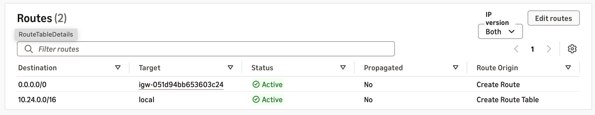
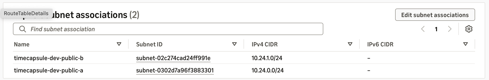
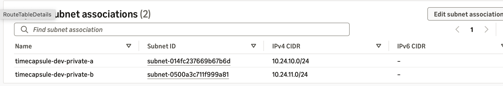
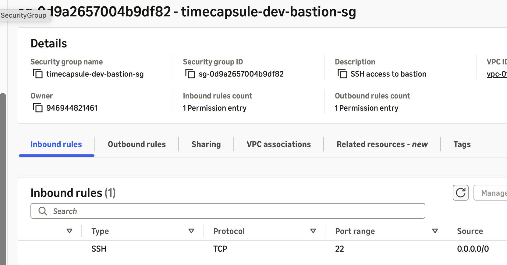
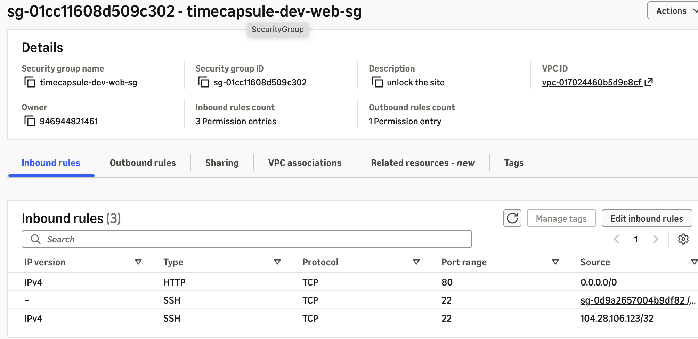
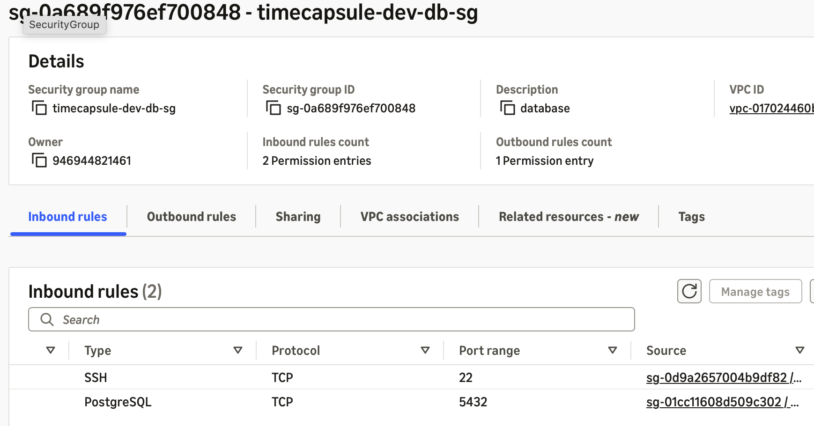
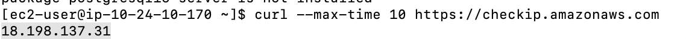
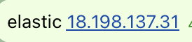
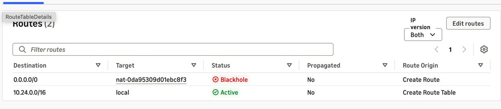
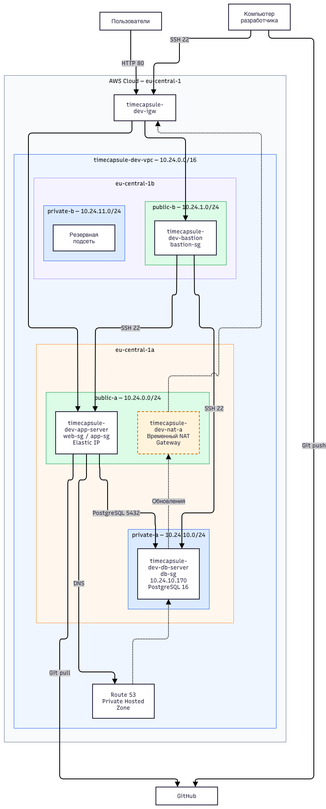

# Лабораторная работа №3. Сетевая инфраструктура AWS

**ФИО:** Артем Сигал  
**Группа:** Ia2403
**Специальность:** informatica aplicata 
**Номер k:** 24   

## 1. Адресация сети

Регион: `eu-central-1`. VPC: `timecapsule-dev-vpc`.

| Ресурс | CIDR / приватный IP | Назначение |
|---|---|---|
| VPC | 10.24.0.0/16 | Виртуальная сеть |
| public-a | 10.24.0.0/24 | Веб-сервер / приложение |
| public-b | 10.24.1.0/24 | Bastion |
| private-a | 10.24.10.0/24 | База данных |
| private-b | 10.24.11.0/24 | Резервная подсеть |
| web-server | 10.24.0.42 | Веб-сервер |
| bastion | 10.24.1.198 | SSH-доступ |
| db-server | 10.24.10.170 | PostgreSQL |
| app-server | [указать актуальный IP] | Приложение |

Зоны доступности и актуальные адреса экземпляров необходимо сверить в AWS.

## 2. Задание 3. Таблицы маршрутизации

## 3. Задание 4. Security Groups

## 4. Задание 5. Проверка экземпляров

Проверил экземпляры, все 3 запущены и работают. Статус : Running.

## 5. Задание 6. Временный NAT Gateway

Совдал с Elastic IP 

Дальше удалил NAT Gateway и дождался состояния : DELETED

**Почему внешний адрес не является адресом db-server?** NAT Gateway заменяет исходный приватный адрес публичным адресом шлюза. Поэтому внешние сервисы видят Elastic IP NAT Gateway, а не 10.24.10.170.

**Какие механизмы защищают базу?** Отсутствие публичного IP и прямого маршрута через Internet Gateway исключает прямой доступ из интернета. Security Group ограничивает сетевые подключения, а pg_hba.conf определяет разрешённые адреса и способ аутентификации PostgreSQL. Ошибка в одном механизме может либо заблокировать легитимный доступ, либо ослабить защиту; остальные механизмы продолжают действовать независимо.

**Почему PostgreSQL работает без NAT?** Пакеты уже установлены, а приложение обращается к базе по локальному маршруту VPC. Для обновлений необходимо временно восстановить NAT Gateway и маршрут, затем снова удалить их и освободить Elastic IP.

## 6. Задание 7. Проверки

Выполнил все проверки. 
**Почему порт 5432 открыт с web-server, но закрыт с bastion?** Правило db-sg разрешает порт 5432 только источникам из web-sg. Наличие маршрута между экземплярами не отменяет фильтрацию Security Group.

**Почему db-server не имеет доступа в интернет?** После удаления NAT в приватной таблице остаётся только локальный маршрут VPC. У базы нет публичного IP, прямого маршрута из интернета и разрешающего правила для внешних клиентов на порту 5432.

**Почему Network ACL блокирует SSH и HTTP?** ACL фильтрует трафик на границе подсети независимо от Security Group. Правила проверяются по возрастанию номера, поэтому Deny 90 срабатывает раньше Allow 100. Телефон с другим публичным IP не подпадает под запрет.

**Зачем нужны теги Project и Owner?** По тегу Project можно найти связанные ресурсы через Tag Editor и определить, что необходимо удалить. Owner помогает установить ответственного за ресурс и упрощает учёт даже в личном аккаунте.

## Архитектура и решение

Архитектурное решение: [ADR-0002. Размещение базы данных](docs/adr/0002-database-placement.md).

### Дополнительные контрольные вопросы

**1. Как проходит запрос от браузера до базы данных?** Браузер обращается к публичному Elastic IP приложения через Internet Gateway и публичную подсеть. Network ACL и Security Group приложения проверяют входящий HTTP-трафик. Приложение разрешает приватное DNS-имя базы через Route 53 и подключается по локальному маршруту VPC к порту 5432; доступ проверяют ACL, db-sg и PostgreSQL (pg_hba.conf и пароль).

**2. Что нужно злоумышленнику для подключения к базе, если он знает её IP?** Ему необходим сетевой доступ к VPC из разрешённого источника, например через скомпрометированный сервер приложения. Кроме того, потребуется пройти фильтры Security Group и pg_hba.conf и получить действительные учётные данные PostgreSQL.

**3. Чем временный NAT лучше постоянного?** Временный NAT уменьшает расходы, поскольку используется только во время установки пакетов и обновлений. Недостаток — необходимость каждый раз создавать шлюз, настраивать маршрут, ждать готовности и удалять ресурсы после завершения работ.

**4. Что нужно для переживания отказа eu-central-1a?** Необходимо развернуть дополнительный сервер приложения в другой зоне и использовать балансировщик нагрузки. Базе требуется репликация или управляемая Multi-AZ конфигурация с переключением при отказе. Для независимого выхода приватных подсетей в интернет при необходимости понадобятся NAT в разных зонах и отдельные таблицы маршрутизации.

## Вывод

В рамках лабораторной работы рассматривается разделение инфраструктуры AWS на публичные и приватные подсети, ограничение доступа с помощью Security Groups и Network ACL, размещение PostgreSQL в приватной сети и использование временного NAT Gateway для обновлений. Итоговая архитектура и фактические результаты проверок подтверждаются приложенными скриншотами.
